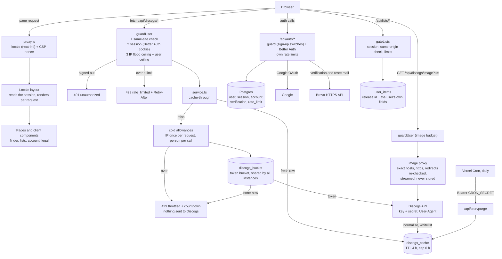

# Architecture

One Next.js (App Router) application on Vercel (Hobby, region `fra1`), one Postgres database on Neon (eu-central-1), and three outside
services: Discogs (read-only data), Google (sign-in) and Brevo (email). Decisions behind the shape: [docs/adr/](adr/README.md).

## Request flow

## The pieces

| Piece | Where | Notes |
| --- | --- | --- |
| Proxy | `src/proxy.ts` | Locale negotiation, and a fresh CSP nonce per page request ([ADR 0005](adr/0005-csp-rollout.md)). |
| Pages | `src/app/[locale]/…` | Every URL carries its locale (`uk`, `en`, `nb`). Pages are dynamic: the layout reads the session. Unknown addresses end in `[...rest]` and a localized 404. |
| Auth | `src/server/auth/`, `/api/auth/*` | Better Auth: email + password (verification required) and Google. Sessions are Postgres rows. `guard.ts` applies the two sign-up switches. OAuth tokens are never stored (`oauth-tokens.ts`). |
| Discogs client | `src/server/discogs/` | `client.ts` (auth, retries, backoff with jitter), `token-bucket.ts` (shared budget), `cache.ts` (TTL cache), `service.ts` (cache-through, batches), `image.ts` (proxy), `http.ts` (guard, schemas, responses). |
| Limits | `src/server/limits.ts`, `rate-limit.ts` | Postgres fixed-window counters ([ADR 0002](adr/0002-postgres-rate-limiting.md)); numbers in `docs/operations.md` section 17. |
| Lists | `src/server/lists/`, `/api/lists/*` | `user_items`: one list per pressing, notes, condition. No Discogs content. |
| Email | `src/server/email/` | Brevo over HTTPS; Resend behind a switch ([ADR 0004](adr/0004-brevo-free-mail-sender.md)). |
| Design system | `public/ds/` (vendored, never edited), `src/ds/`, `src/app/ds-extensions.css` | Thin typed wrappers over the system's own classes; fixes live in our CSS. |
| Database | `src/server/db/`, `drizzle/` | Neon serverless driver; dev and production are separate branches ([ADR 0001](adr/0001-two-databases.md)). |

## What each layer answers

| Situation | Answer | Who handles it |
| --- | --- | --- |
| Not signed in | `401 unauthorized`; pages show "Sign in to search" | `guardUser`, page checks |
| Request from another site | `403 forbidden` | `isCrossSite` (Sec-Fetch-Site) |
| Too many requests from an IP or user | `429 rate_limited` + `Retry-After` | `guardUser` |
| This IP or person spent its cold allowance | `429 throttled` (batches: `missing` + `retryAfter`) | `coldIp`, `coldLimiter` |
| Discogs budget used up or Discogs said 429 | `429 throttled` + countdown, automatic retry twice | token bucket, `client.ts` |
| Discogs error or unexpected shape | `502 upstream`; the screen offers a retry | `service.ts`, `respond` |
| Release removed on Discogs | `404`; batches report `gone`; the card says "No longer on Discogs" | `service.ts` |
| Discogs credentials missing | `503 unconfigured`; the screen says details are not set up | `client.ts` |

## Where the Discogs Terms are enforced

See [discogs-compliance.md](discogs-compliance.md): each rule with the code and the test that cover it.
